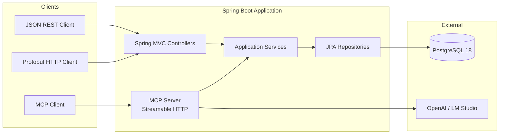
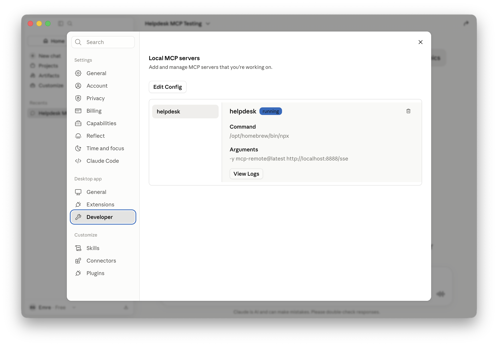
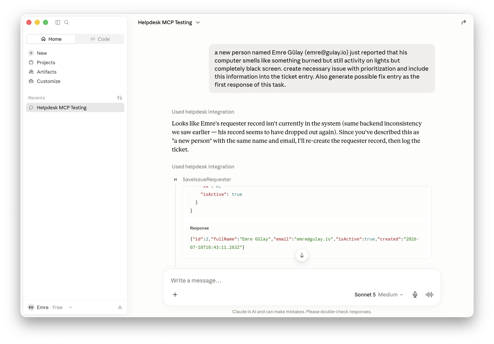
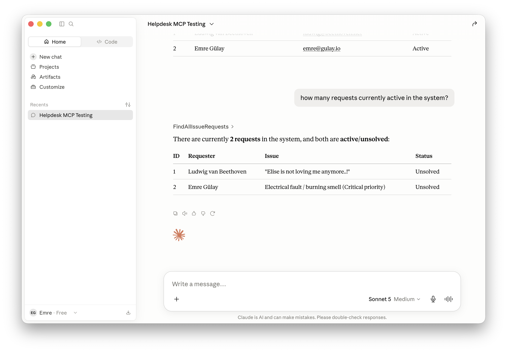
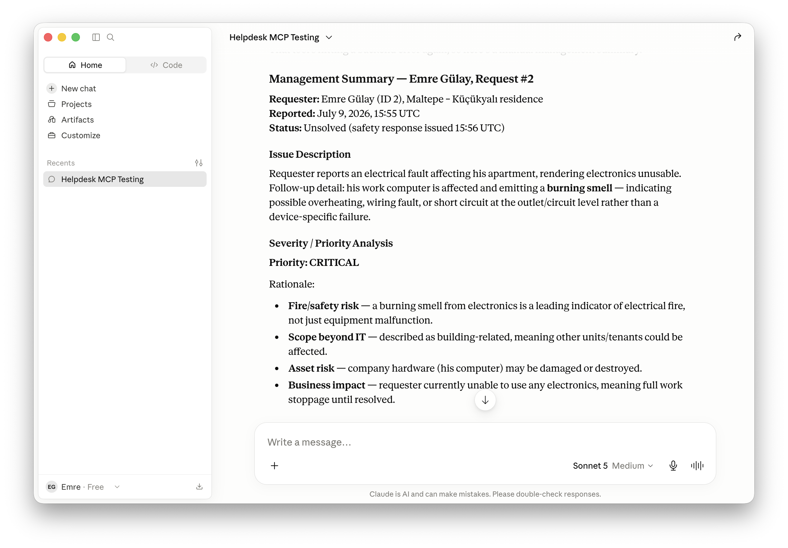
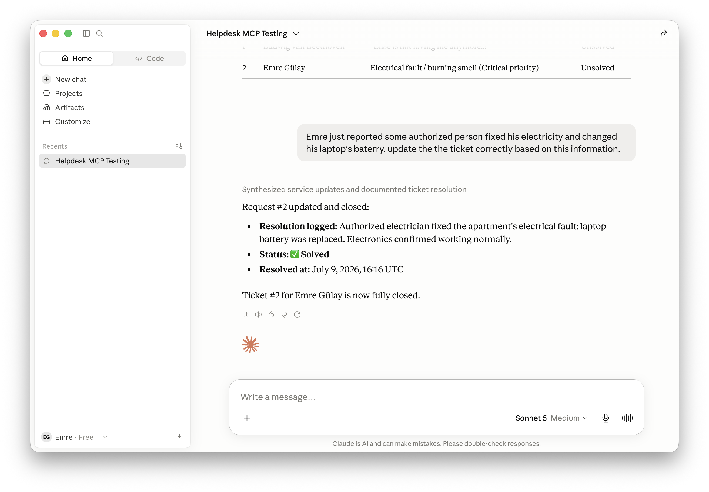
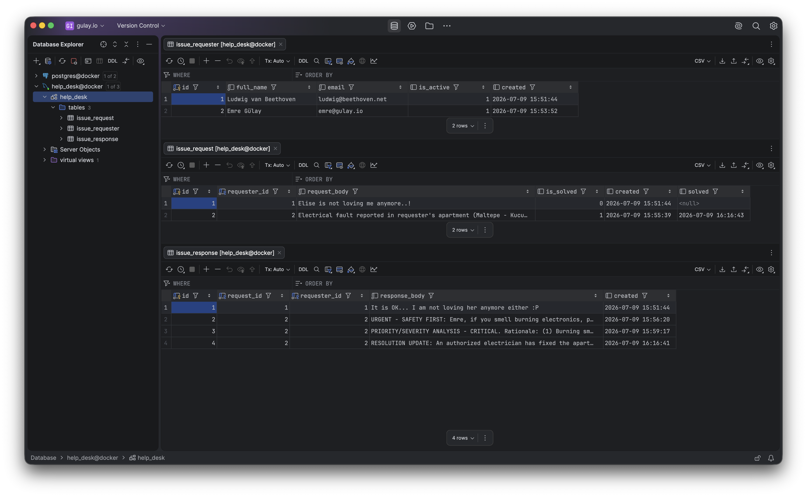

> [!WARNING]
> **Template and reference implementation — not a commercial product**
>
> This project is shared as an educational, architectural, and API-design template.
> It provides a working foundation that can be studied, tested, extended, and adapted
> for real applications, but it is not offered as a finished commercial helpdesk
> product. Production use requires evaluation and adaptation for the target
> organization’s security, compliance, availability, operational, and business needs.
>
> 🇹🇷 **Önemli Not**
>
> Bu proje; eğitim, mimari referans ve API tasarım şablonu olarak paylaşılmıştır.
> İncelenebilen, test edilebilen, geliştirilebilen ve gerçek uygulamalara uyarlanabilen
> çalışan bir temel sunar; ancak tamamlanmış ticari bir yardım masası ürünü değildir.
> Üretim ortamında kullanılmadan önce hedef kurumun güvenlik, mevzuat, erişilebilirlik,
> operasyon ve iş ihtiyaçlarına göre değerlendirilmesi ve uyarlanması gerekir.

# Dummy Helpdesk API

[](https://openjdk.org/projects/jdk/21/)
[](https://spring.io/projects/spring-boot)
[](https://modelcontextprotocol.io/)
[](LICENSE)

Helpdesk is a template Spring Boot application that exposes one service and persistence layer through three interfaces:

- a resource-oriented HTTP API using JSON;
- the same HTTP resources using binary Protocol Buffers;
- an embedded Model Context Protocol (MCP) server with data and AI-assistant tools.

The project is intentionally hybrid. It is **not a gRPC server**: it does not expose gRPC services, generated stubs, or gRPC framing. Instead, Spring MVC serializes Protobuf messages directly over ordinary HTTP and selects JSON or binary Protobuf through content negotiation. HTTP/2 is enabled at the server level but does not by itself select the representation.

## Architecture



The main packages are:

```text
io.gulay.helpdesk.controller       HTTP resources and content-negotiated errors
io.gulay.helpdesk.data.model       JPA entities
io.gulay.helpdesk.data.repository  Spring Data repositories
io.gulay.helpdesk.data.service     transactional application services
io.gulay.helpdesk.mcp.client       OpenAI, LM Studio, and disabled AI clients
io.gulay.helpdesk.mcp.dto          JSON-friendly MCP request/response DTOs
io.gulay.helpdesk.mcp.tools        read, mutation, and assistant MCP tools
src/main/proto                HTTP payload and API error schemas
src/main/resources/db         Flyway migrations
```

## Technology

- Java 21
- Spring Boot 4.1
- Spring MVC, Spring Data JPA, Validation, Actuator, and Cache
- Spring AI MCP Server over WebMVC Streamable HTTP
- PostgreSQL 18, Hibernate, and Flyway
- Google Protocol Buffers
- OpenAI Java SDK, with OpenAI-compatible LM Studio support
- Spring Cloud Vault
- Maven Wrapper, Maven Enforcer, and JaCoCo
- JUnit 5 (Jupiter) integration tests on the JUnit Platform
- Testcontainers with PostgreSQL 18

## Requirements

- Java 21
- Docker Desktop or another Docker-compatible runtime
- `bash`, `curl`, and `jq` for the helper scripts

Maven and `protoc` do not need to be installed globally. The committed Maven Wrapper downloads Maven, and the build resolves the correct platform-specific `protoc` artifact.

## Hybrid HTTP contract

The canonical resource URLs are:

```text
/api/v1/issue-requesters
/api/v1/issue-requests
/api/v1/issue-responses
```

Representation selection is explicit:

| Representation | `Accept` response header | `Content-Type` request header |
|---|---|---|
| Protobuf JSON | `application/json` | `application/json` |
| Binary Protobuf | `application/x-protobuf` | `application/x-protobuf` |

Use JSON for conventional REST clients:

```bash
curl -sS \
  -H 'Accept: application/json' \
  http://localhost:8888/api/v1/issue-requesters/1
```

Use binary Protobuf when the client has the schemas from `src/main/proto`:

```bash
curl -sS \
  -H 'Accept: application/x-protobuf' \
  http://localhost:8888/api/v1/issue-requesters/1 \
  --output requester.bin
```

For writes, the request and response formats can be negotiated independently. This JSON example creates a requester and asks for JSON back:

```bash
curl -sS -X POST http://localhost:8888/api/v1/issue-requesters \
  -H 'Content-Type: application/json' \
  -H 'Accept: application/json' \
  -d '{
    "fullName": "Ada Lovelace",
    "email": "ada@example.com",
    "isActive": {"data": true}
  }'
```

Nullable scalar fields use the wrapper messages in `Common.proto`, so their Protobuf JSON form is an object such as `{"data": true}` rather than a bare Boolean.

### HTTP/2 clarification

`server.http2.enabled=true` enables HTTP/2 when the selected embedded-server/TLS setup supports it. The HTTP protocol version is transport-level information; it does not automatically make a response binary. Clients must send `Accept: application/x-protobuf` to request Protobuf bytes. This keeps HTTP/1.1 and HTTP/2 behavior deterministic and cache-friendly.

## Canonical routes

| Method | Route | Purpose |
|---|---|---|
| `GET` | `/api/v1/issue-requesters` | List requesters |
| `GET` | `/api/v1/issue-requesters/{id}` | Get a requester |
| `POST` | `/api/v1/issue-requesters` | Create or update a requester |
| `PUT` | `/api/v1/issue-requesters/{id}/activation` | Toggle activation |
| `DELETE` | `/api/v1/issue-requesters/{id}` | Hard-delete a requester |
| `GET` | `/api/v1/issue-requests` | List requests |
| `GET` | `/api/v1/issue-requests/{id}` | Get a request |
| `POST` | `/api/v1/issue-requests` | Create or update a request |
| `PUT` | `/api/v1/issue-requests/{id}/resolution` | Mark a request solved |
| `DELETE` | `/api/v1/issue-requests/{id}` | Hard-delete a request |
| `GET` | `/api/v1/issue-responses` | List responses |
| `GET` | `/api/v1/issue-responses/{id}` | Get a response |
| `POST` | `/api/v1/issue-responses` | Create or update a response |
| `DELETE` | `/api/v1/issue-responses/{id}` | Hard-delete a response |

List routes accept `pageNo`, `pageSize`, `sortBy`, and `sortDir`. They also support the date filters implemented by each controller. HTTP date query values are Unix epoch milliseconds.

Some specialized searches—requester name/email, requests by requester/solved state, and responses by requester/request—are available under `/api/v1`; consult the generated OpenAPI document for the complete route list.

## Errors

Errors use the `ApiError` Protobuf schema and follow the same negotiation rule:

- an explicit `Accept: application/x-protobuf` receives binary `ApiError` bytes;
- JSON or broader/default negotiation receives Protobuf JSON.

The error payload contains `status`, `error`, `message`, `path`, and an epoch-millisecond `timestamp`. Unexpected internal exceptions are logged server-side and return a generic message rather than exposing implementation details.

## Persistence and migrations

Flyway is enabled and validates/applies migrations during application startup. The initial production schema is:

```text
src/main/resources/db/migration/V1__create_helpdesk_schema.sql
```

This migration is the single schema source of truth for local development,
tests, and deployed environments. Integration tests start an empty PostgreSQL
Testcontainer and let Flyway apply the same migrations used by the
application. Tests create their fixtures through the application services.

The entities map to the `help_desk` schema. A PostgreSQL schema is not a
database, so `spring.flyway.schemas=help_desk` makes Flyway create that schema
and apply the migrations inside it; the Flyway history table lives there too.

The PostgreSQL driver forwards the JVM default time zone to the server as the
session `TimeZone`, and PostgreSQL rejects deprecated tzdata aliases such as
`Turkey`. The test JVM and `run.sh` therefore default to UTC, which also keeps
stored timestamps aligned with the database container.

The initial migration defines foreign keys, a unique requester email constraint,
and query-oriented indexes. Add new versioned migrations instead of modifying a
migration already used by an environment.

Service reads run in read-only transactions. Mutations run in regular transactions and flush before returning so validation and database constraint failures are mapped within the service boundary.

## Configuration

The default application port is `8888`. Important settings are:

```yaml
helpdesk:
  ai:
    enabled: true
    provider: lm-studio # lm-studio or openai
    lm-studio:
      base-url: http://localhost:1234/v1
      model: unsloth/Qwen3-Coder-30B-A3B-Instruct-GGUF
    openai:
      base-url: https://api.openai.com/v1
      model: gpt-5.2
  mcp:
    allow-mutations: false
```

| Property | Meaning |
|---|---|
| `helpdesk.ai.enabled` | Creates a real AI provider client when `true`; uses a disabled client when `false` |
| `helpdesk.ai.provider` | Selects `lm-studio` or `openai` |
| `helpdesk.ai.lm-studio.*` | Local OpenAI-compatible endpoint and model |
| `helpdesk.ai.openai.*` | Hosted OpenAI endpoint, model, and Vault-provided API key |
| `helpdesk.mcp.allow-mutations` | Registers MCP mutation tools only when `true`; HTTP mutations are unaffected |
| `HELPDESK_OPENAPI_ENABLED` | Enables/disables OpenAPI JSON and Swagger UI; default `true` |
| `MANAGEMENT_ENDPOINTS` | Comma-separated exposed Actuator endpoints; default `health,info` |

`helpdesk.ai.enabled=false` prevents external AI client creation, but assistant tool calls will then report that AI is disabled. Read-only database MCP tools remain available.

## MCP server

The MCP server runs in the same process as the HTTP API:

```text
Streamable HTTP endpoint: http://localhost:8888/mcp
server mode:              synchronous
server request timeout: 5 minutes
```

MCP tools return dedicated DTOs rather than JPA entities. Available tool groups are:

- requester, request, and response lookup/search tools;
- assistant tools for summaries, response suggestions, priority/category estimation, timelines, escalation summaries, and draft knowledge-base articles;
- optional mutation tools for save/update, activation, resolution, and hard deletion.

### Mutation safety

MCP data access is read-only by default:

```yaml
helpdesk:
  mcp:
    allow-mutations: false
```

Set it to `true` only for trusted MCP clients. This flag controls MCP tool registration only; it does not disable `POST`, `PUT`, or `DELETE` HTTP endpoints.

## Vault and AI providers

Outside the `test` profile, the application optionally imports `vault://`. Vault is used for datasource properties and the OpenAI API key. The helper scripts use `secret/helpdesk`.

For LM Studio, start a local OpenAI-compatible server at the configured URL. No API key is required by this project.

For OpenAI, select the provider and export the key before running the setup scripts:

```bash
export OPENAI_API_KEY='your-key'
```

`build.sh` and `run.sh` patch it into Vault as `helpdesk.ai.openai.api-key`. Avoid committing keys to YAML or source control.

## Quick start

The easiest local setup is:

```bash
./build.sh
./run.sh
```

`build.sh`:

1. starts or reuses PostgreSQL 18;
2. verifies that the configured database is reachable and repairs the local application role, database, and privileges when an administrative role is reachable;
3. starts or reuses Vault in development mode;
4. creates datasource secrets and optionally stores `OPENAI_API_KEY`;
5. runs `./mvnw clean verify`.

`build.sh` does not create application tables directly. Its Maven verification
uses Flyway inside Testcontainers. `run.sh` verifies the Vault container and
secret, optionally patches the OpenAI key, and starts Spring Boot with the
embedded MCP server enabled; application startup then lets Flyway create or
migrate the local schema. Neither script prints secret values.

To recreate the local PostgreSQL container during setup:

```bash
RESET_DB=true ./build.sh
```

If the `help_desk` schema contains helpdesk tables without a
`flyway_schema_history` table, `build.sh` stops instead of deleting or
silently baselining that data. Back up anything required and use the explicit
`RESET_DB=true` command to recreate the local development database.

The scripts support overrides such as `POSTGRES_PORT`, `POSTGRES_DB`, `POSTGRES_USER`, `POSTGRES_PASSWORD`, `POSTGRES_SCHEMA`, `VAULT_PORT`, `VAULT_CONTAINER`, `SECRET_PATH`, and the corresponding container/image variables.

## Manual local infrastructure

If you do not use `build.sh`, start PostgreSQL and Vault yourself:

```bash
docker run -d --name postgres18 \
  -p 5432:5432 \
  -e POSTGRES_DB=help_desk \
  -e POSTGRES_USER=help_user \
  -e POSTGRES_PASSWORD=help_pass \
  postgres:18

docker run -d --name vault \
  -p 8200:8200 \
  -e VAULT_DEV_ROOT_TOKEN_ID=root \
  -e VAULT_DEV_LISTEN_ADDRESS=0.0.0.0:8200 \
  hashicorp/vault:latest \
  server -dev -dev-root-token-id=root -dev-listen-address=0.0.0.0:8200
```

Then set:

```bash
export VAULT_ADDR=http://localhost:8200
export VAULT_TOKEN=root
```

Create `secret/helpdesk` with the datasource properties shown in `build.sh`, then start the application with `./run.sh`. Flyway will manage the application schema.

## Build and tests

Run the complete verification pipeline with:

```bash
./mvnw verify
```

The current suite uses the existing shared `TestBase`, starts PostgreSQL 18 through Testcontainers, lets Flyway create the schema, and runs controller, service, and MCP-configuration integration tests. Controller coverage verifies JSON responses, binary Protobuf responses, JSON writes, and binary typed errors for all three resources.

The build also:

- enforces supported Java/Maven versions and rejects duplicate dependency declarations;
- generates Java classes from all `.proto` files;
- builds the executable Spring Boot JAR;
- writes a JaCoCo HTML report to `target/site/jacoco/index.html`.

The last verified suite contains 138 tests.

## Test the MCP transport

With the application running, execute:

```bash
./test-mcp.sh
```

The script creates a Streamable HTTP session at `/mcp`, performs the MCP initialization handshake, requests `tools/list`, and prints the discovered tool names. It requires `curl` and `jq`.

## MCP client example

For clients that need a local stdio-to-remote bridge, an example Claude Desktop configuration is:

```json
{
  "mcpServers": {
    "helpdesk": {
      "command": "/opt/homebrew/bin/npx",
      "args": [
        "-y",
        "mcp-remote@latest",
        "http://localhost:8888/mcp"
      ]
    }
  }
}
```

Adjust the `npx` path for your operating system and restart the MCP client after changing its configuration.

## API documentation and operations

When enabled:

```text
OpenAPI JSON:  http://localhost:8888/api-docs
Swagger UI:    http://localhost:8888/swagger-ui.html
Health:        http://localhost:8888/actuator/health
Info:          http://localhost:8888/actuator/info
```

Disable public API documentation with `HELPDESK_OPENAPI_ENABLED=false`. Expose additional Actuator endpoints only deliberately through `MANAGEMENT_ENDPOINTS`.

## Screenshots








## License

Released under the [MIT License](LICENSE). Copyright © 2025 Emre Gülay.
